# 🛡️ RecoveryProof

**Prove recovery before disaster strikes.**

RecoveryProof is an evidence-based disaster-recovery and cyber-resilience analysis
platform. It answers one question for IT leadership: *if ransomware, a compromised
administrator, or an infrastructure failure hit today, could our critical systems
actually be recovered — in what order, how fast, and with how much data loss?*

It analyses infrastructure and backup **evidence**, models system dependencies,
calculates RTO/RPO compliance, simulates incidents, recommends a safe recovery
sequence and produces reports that leadership can read and engineers can trace.

> RecoveryProof is a **decision-support tool**. It does not perform restores, remove
> ransomware, revoke credentials or change any system, and it does not guarantee
> recovery. The bundled demo runs entirely on **synthetic data** for a fictional company.

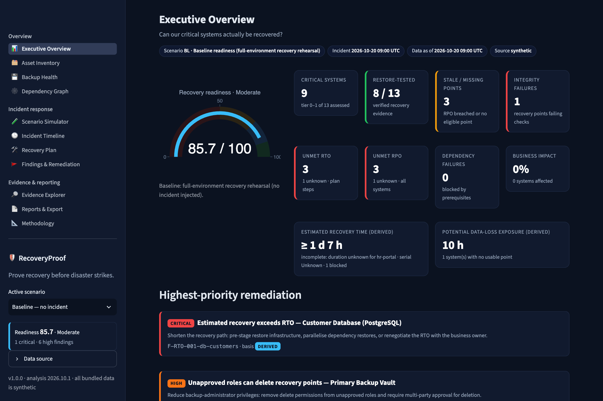
<sub>Executive Overview for the synthetic baseline: readiness 85.7/100 (Moderate). 8 of 13 systems have restore-tested evidence; prioritised remediation below. Screenshot of the running app.</sub>

---

## Contents

1. [The business problem](#the-business-problem)
2. [Features](#features)
3. [Architecture](#architecture)
4. [Screenshots](#screenshots)
5. [Installation and quick start](#installation-and-quick-start)
6. [Scenario walkthroughs](#scenario-walkthroughs)
7. [Example output](#example-output)
8. [RTO and RPO](#rto-and-rpo)
9. [Scoring methodology](#scoring-methodology)
10. [Testing results](#testing-results)
11. [Security model](#security-model)
12. [Limitations](#limitations)
13. [Roadmap](#roadmap)
14. [License and contributing](#license-and-contributing)

---

## The business problem

Most organisations *believe* they have backups. During a real incident those backups
often turn out to be:

- **stale** — the jobs silently failed days ago;
- **corrupted** — the newest point fails integrity checks;
- **reachable by the attacker** — a stolen backup-admin credential can delete them;
- **unusable on their own** — the application backup is fine, but the database, identity
  provider or encryption key it depends on cannot be restored;
- **untested** — nobody has ever restored them end-to-end.

RecoveryProof treats *backup existence as a claim, not as proof*. A recovery point only
counts when evidence supports it, and every conclusion links to the evidence and rule
that produced it.

## Features

| Area | What it does |
|---|---|
| **Executive overview** | Readiness score with explanation, critical systems, restore-tested systems, stale/missing points, integrity failures, unmet RTO/RPO, dependency failures, recovery-time and data-loss estimates, top remediation |
| **Asset inventory** | 15 synthetic assets: web apps, APIs, databases, identity, KMS, file storage, logging, monitoring, backup vaults, an AWS-style S3 resource. Search, filters, drill-down |
| **Backup assessment** | Evaluates freshness, RPO, integrity *evidence* vs. reported status, restore tests (kept separate from integrity checks), isolation/immutability evidence, access exposure, retention, encryption, contradictory/missing evidence |
| **Dependency engine** | Directed graph (`dependency → dependent`), cycle and missing-dependency detection, impact analysis, shared-dependency detection, prioritised topological recovery order with waves and timing |
| **Scenario simulator** | 10 deterministic scenarios (5 required + 5 variations): run, reset, compare before/after, and an in-app expected-vs-actual regression check |
| **Remediation engine** | One recommendation per finding: ID, severity, asset, evidence, business impact, action, reason, verification procedure, expected outcome, status. Resolving requires a verification record |
| **Evidence & audit** | Stable finding/evidence/scenario IDs, rule IDs, calculation text, analysis version, evidence explorer, hash-chained local audit trail |
| **Reports** | HTML and PDF executive reports, findings JSON, recovery-plan JSON, full analysis JSON. All generated from the same analysis object the dashboard renders |
| **Basis labels** | Every finding is tagged **verified**, **simulated**, **derived** or **unknown**; unknowns are shown as unknown, never assumed |

## Architecture

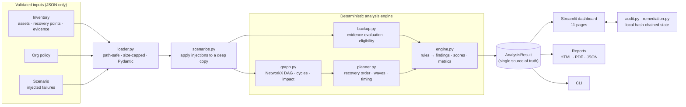

Every surface (dashboard, reports, JSON, CLI) renders the same `AnalysisResult`, so
the numbers always agree. See [docs/architecture.md](docs/architecture.md) for the module
breakdown and design decisions.

## Screenshots

All screenshots are real captures of the locally running app. See the
[screenshot manifest](docs/screenshots/README.md) for how each one was produced and verified.

| | |
|---|---|
| 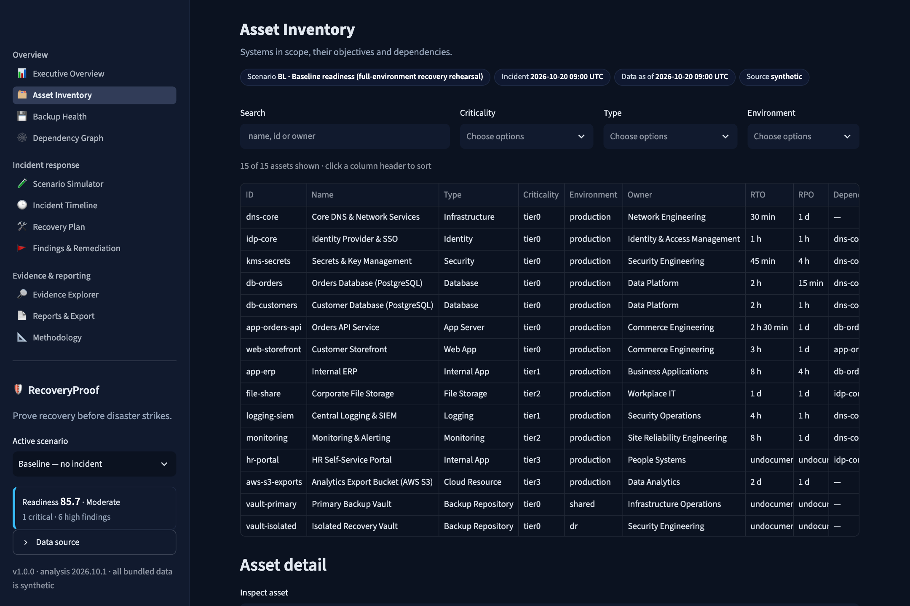 <br/><sub>**Asset Inventory**: criticality, RTO/RPO, dependencies and recovery evidence per system.</sub> | 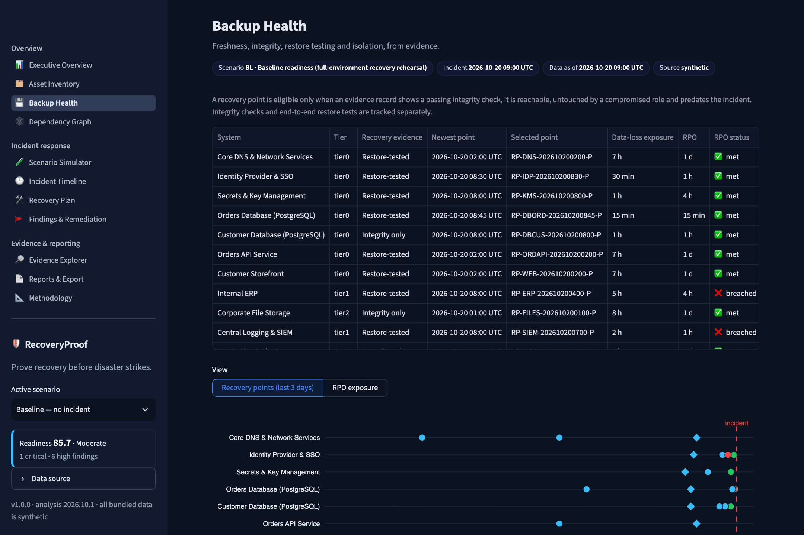 <br/><sub>**Backup Health**: evidence-based eligibility, data-loss exposure vs. RPO, isolation and restore tests.</sub> |
| 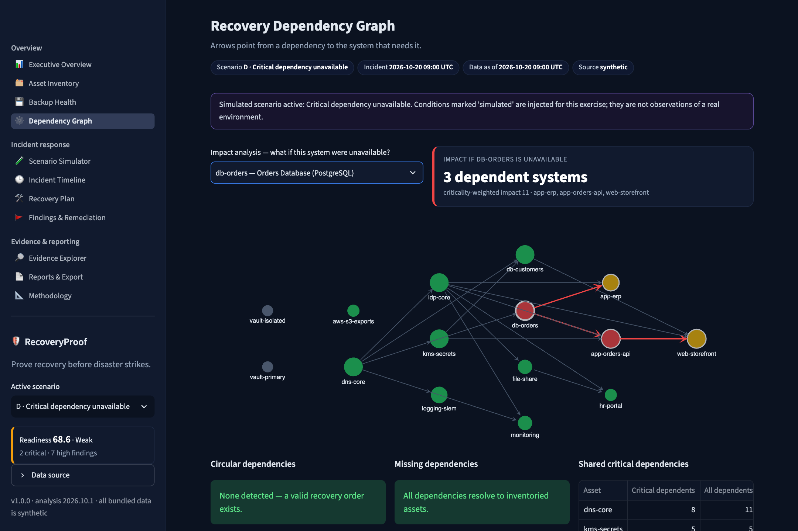 <br/><sub>**Dependency graph** (Scenario D): blocked nodes in red; impact analysis highlights what fails if `db-orders` is lost.</sub> | 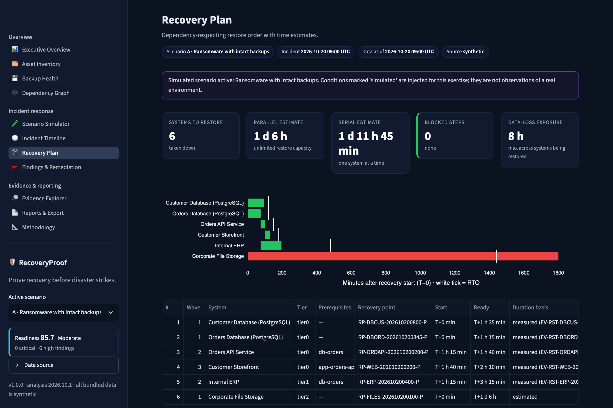 <br/><sub>**Scenario A recovery plan**: dependency-ordered restore; Corporate File Storage misses its RTO.</sub> |
| 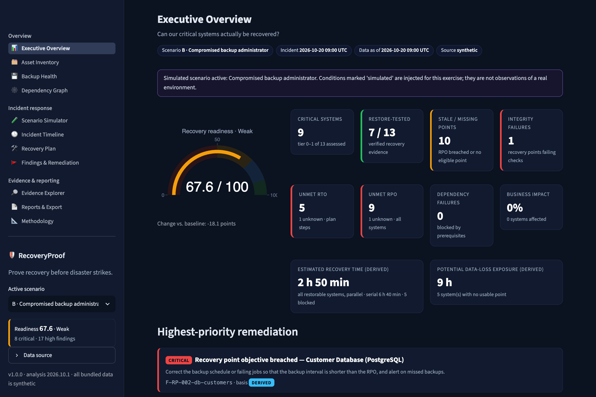 <br/><sub>**Scenario B**: readiness drops to 67.6; primary-vault points become untrusted.</sub> | 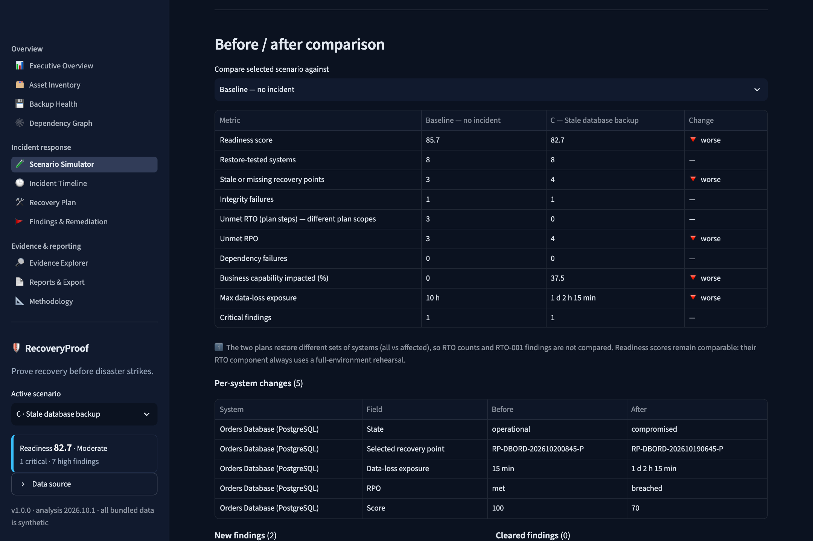 <br/><sub>**Scenario C** before/after: orders DB exposure goes from 15 min to 1 d 2 h 15 min against a 15-min RPO.</sub> |
| 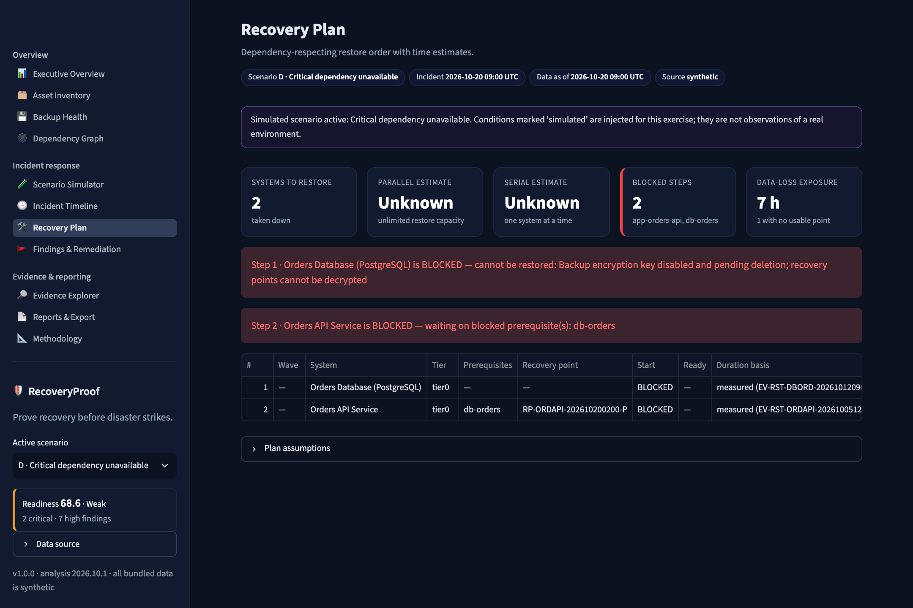 <br/><sub>**Scenario D**: the Orders API backup is intact but blocked, because the database cannot be decrypted.</sub> | 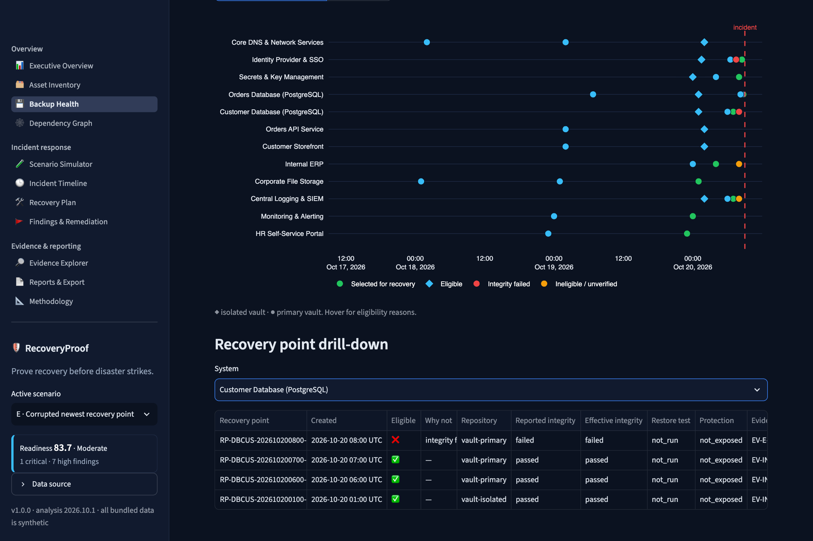 <br/><sub>**Scenario E**: newest point fails integrity; recovery falls back to 07:00.</sub> |
| 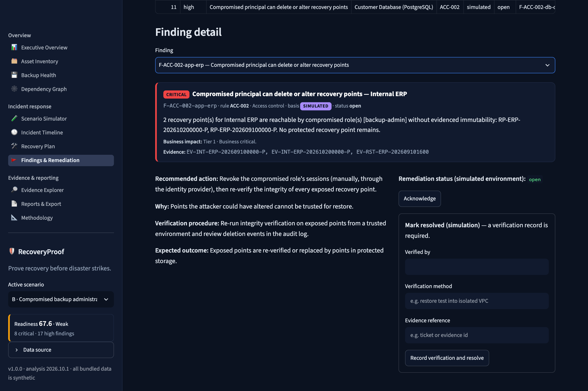 <br/><sub>**Findings & Remediation**: action, verification procedure and a status that requires a verification record.</sub> | 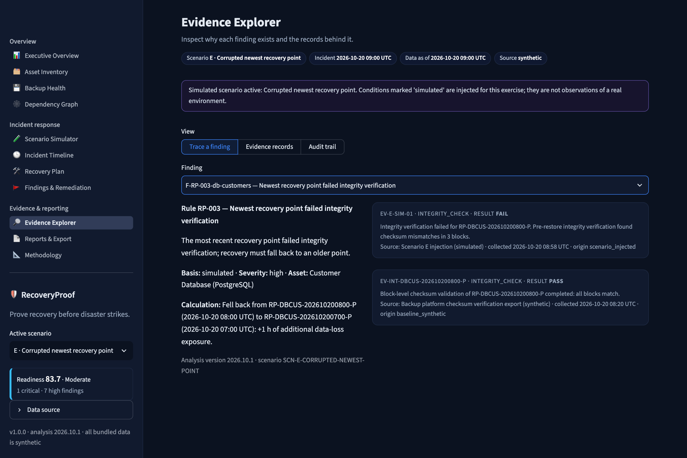 <br/><sub>**Evidence Explorer**: a finding traced to the simulated failed integrity check that caused it.</sub> |

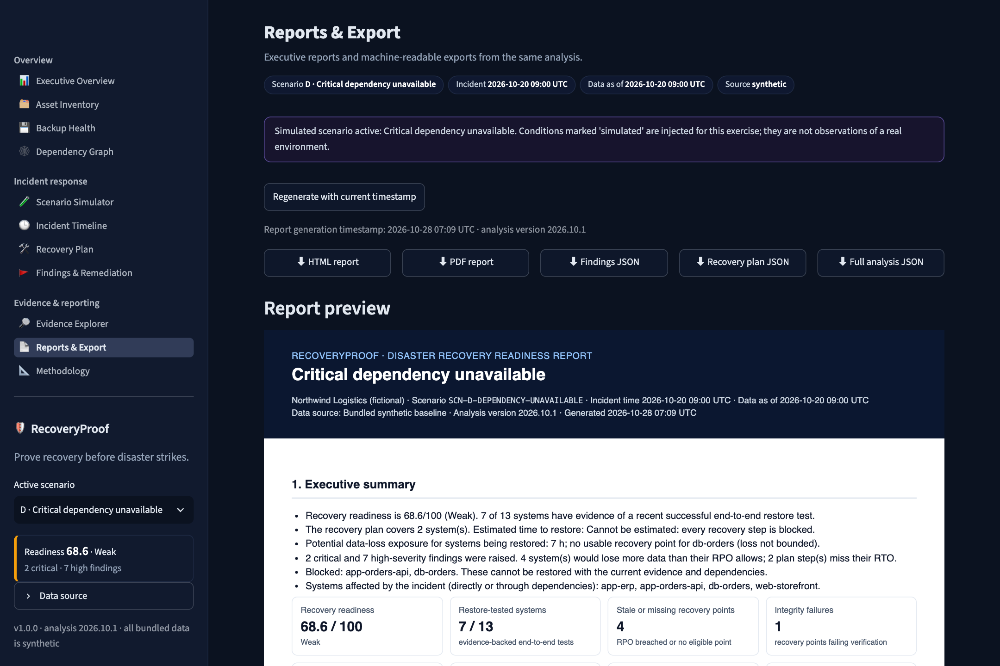
<sub>**Reports & Export**: HTML/PDF/JSON downloads and the executive report preview for Scenario D.</sub>

## Installation and quick start

Requirements: Python 3.12+ (tested on 3.13.5). No cloud account, credentials, API keys
or external services are needed.

```bash
git clone <this repository> recoveryproof && cd recoveryproof
python3 -m venv .venv && source .venv/bin/activate
pip install -e .
streamlit run app.py
```

Open http://localhost:8501. Pick a scenario in the sidebar (or open
`http://localhost:8501/?scenario=B`). For an exact, tested dependency set:
`pip install -c requirements-lock.txt -e .`

Command line:

```bash
recoveryproof scenarios
recoveryproof analyze --scenario C --check
recoveryproof report --scenario D --format pdf --out report.pdf
```

Development:

```bash
pip install -e ".[dev]"
pytest --cov
ruff check src tests scripts && mypy && bandit -c pyproject.toml -r src scripts
```

## Scenario walkthroughs

Scenarios are JSON files in [`data/scenarios/`](data/scenarios). Each one injects failures
into a copy of the baseline. The baseline itself is never modified. Each scenario
declares its expected outcome, which is checked by the tests and shown in the app.
Figures below are the app's actual output for the bundled data (incident 2026-10-20 09:00 UTC).

| | Scenario | What is injected | Outcome |
|---|---|---|---|
| **A** | Ransomware with intact backups | 6 production systems encrypted; vaults untouched | Readiness 85.7, unchanged from baseline: no recovery capability lost, but 55% of business capability is down. Order: databases → Orders API → Storefront; ERP; file share. Parallel estimate **1 d 6 h**, driven by the 30-h file-share restore, which misses its 24-h RTO. Max data loss 8 h |
| **B** | Compromised backup administrator | `backup-admin` role stolen; ERP points deleted; deletion of an isolated DB copy attempted | The isolated vault's **evidenced compliance-mode lock** blocks the deletion. Every primary-vault point becomes untrusted, because governance mode can be bypassed by that role. Restorable systems must use isolated copies, causing RPO breaches (orders DB: 8 h vs 15 min). 5 systems have **no trusted point**. Readiness **67.6 (Weak)**, 8 critical findings |
| **C** | Stale database backup | Backup jobs failing since 2026-10-19 07:00; orders DB corrupted by a migration | Newest eligible point 2026-10-19 06:45 → exposure **1 d 2 h 15 min** vs 15-min RPO (gap exactly 26 h). Orders API, Storefront and ERP flagged as impacted |
| **D** | Critical dependency unavailable | Orders API encrypted; attacker disables the KMS key protecting the orders-DB backups | `db-orders` cannot be restored. The Orders API **has an intact backup but is blocked**. DEP-003 explains why restoring the app alone is insufficient: criticality-weighted impact 11 across API, Storefront and ERP. The recovery time is reported as *cannot be estimated*, not "0 min" |
| **E** | Corrupted newest recovery point | Customer DB encrypted; the 08:00 point fails integrity re-verification | Newest eligible point recomputed to 07:00: exposure 2 h vs 60-min RPO, **+1 h** from the corruption. Plan recalculated: 1 h 35 min |
| F | Ransomware after 6-h dwell time | As A, plus nothing after 03:00 is trusted | Every system falls back to pre-03:00 points; 7 RPO breaches |
| G | Primary vault outage | Primary vault unreachable; both databases lost | Recovery uses isolated copies; REPO-001 raised |
| H | Identity provider compromise | IdP, Orders API, Storefront destroyed | IdP restored first; dependants wait |
| I | Full production site loss | Everything down, primary vault lost | Isolated vault only; 5 systems unrecoverable |
| J | Insider deletes file-share backups | `platform-admin` deletes all file-share points, then wipes the share | File share unrecoverable; HR portal impacted through dependency |

## Example output

```text
$ recoveryproof analyze --scenario D
Critical dependency unavailable [SCN-D-DEPENDENCY-UNAVAILABLE]
  readiness        68.6/100 (Weak)
  recovery time    Cannot be estimated: every recovery step is blocked
  data-loss        7 h; no usable recovery point for db-orders (loss not bounded)
  findings         {'critical': 2, 'high': 7, 'medium': 8, 'low': 4, 'info': 0}
  recovery order   db-orders [BLOCKED] -> app-orders-api [BLOCKED]
```

Sample generated reports (synthetic data) are in [`docs/examples/`](docs/examples), for example
[the Scenario D PDF](docs/examples/report-d-scn-d-dependency-unavailable.pdf) and its
[findings JSON](docs/examples/report-d-scn-d-dependency-unavailable-findings.json).

A finding as exported (abridged):

```json
{
  "id": "F-RP-002-db-orders",
  "rule_id": "RP-002",
  "title": "Recovery point objective breached",
  "severity": "critical",
  "asset_id": "db-orders",
  "calculation": "Incident 2026-10-20 09:00 UTC − eligible point RP-DBORD-202610190645-P 2026-10-19 06:45 UTC = 1 d 2 h 15 min exposure; RPO 15 min; gap 1 d 2 h.",
  "basis": "derived"
}
```

## RTO and RPO

- **RTO — Recovery Time Objective:** the longest a service may be down. RecoveryProof
  compares it with the **estimated ready time**: waiting for prerequisites, plus the restore
  duration (measured in a restore test where available, otherwise the documented estimate).
- **RPO — Recovery Point Objective:** the most data, measured as time, the business accepts
  losing. RecoveryProof compares it with **data-loss exposure**: incident time minus the
  newest *eligible* recovery point.

They are independent. A system can be restored quickly (RTO met) from a stale backup
(RPO breached), or from a fresh backup after a long dependency wait (the reverse).

## Scoring methodology

Each system scores up to 100. The overall score is the criticality-weighted mean
(tier 0 = 4, tier 1 = 3, tier 2 = 2, tier 3 = 1).

| Component | Points | Credit |
|---|---|---|
| Backup confidence | 35 | restore-tested 1.0 · integrity-verified only 0.6 · unverified 0.2 · none 0 |
| RPO | 20 | exposure ≤ RPO |
| RTO | 20 | ready time ≤ RTO in a *full-environment* rehearsal (keeps scores comparable across scenarios) |
| Dependencies | 15 | no prerequisite blocked, missing or cyclic |
| Isolation | 10 | evidenced isolated immutable copy 1.0 · claimed 0.5 · none 0 |

Bands: **Strong** ≥ 90 · **Moderate** ≥ 75 · **Weak** ≥ 50 · **Critical** < 50. Unknown
values earn no credit. The score has no AI or random component. Full details, rule
catalogue (23 rules) and assumptions: [docs/methodology.md](docs/methodology.md).

## Testing results

Verified locally on 2026-10-28 (Python 3.13.5, macOS arm64):

| Check | Result |
|---|---|
| `pytest` | **244 passed**, 0 failed (unit, integration, property-based, scenario regression, Streamlit AppTest UI) |
| Coverage | **99%** core engine (excluding UI), **95%** overall (branch coverage) |
| `ruff check` / `ruff format --check` | clean |
| `mypy` (strict, pydantic plugin) | no issues in 27 source files |
| `bandit` | no issues (2 reviewed false positives annotated with `nosec`) |
| `pip-audit` | no known vulnerabilities in the installed dependency set |
| Browser | All 11 pages and all 10 scenarios exercised in a real browser; every scenario's in-app expectation checks pass (see [docs/testing.md](docs/testing.md)) |

A GitHub Actions workflow ([.github/workflows/ci.yml](.github/workflows/ci.yml)) runs lint,
types, security scans, tests on Python 3.12 and 3.13, coverage gates and an app-startup smoke
test. Its result on GitHub is only known once the repository has been pushed and the workflow has run.

## Security model

- All inputs (bundled or uploaded) are treated as **untrusted**: JSON only, size-capped,
  strictly validated (unknown fields rejected, timezone-aware timestamps required), with
  path-traversal and symlink-escape protection.
- No `pickle`, no YAML object construction, no `eval`, no shell commands, no uploaded code.
- All user-controlled text is HTML-escaped in the dashboard and reports.
- No network calls by default (Streamlit telemetry disabled). No cloud credentials needed.
- The app never deletes backups, disables logging, revokes credentials or touches real systems.
  Remediation status changes affect only the local simulation.
- Local audit trail is append-only and hash-chained: **tamper-evident, not tamper-proof**.

Threat model: [docs/threat-model.md](docs/threat-model.md).

## Limitations

- The demo data is synthetic. Results describe the model, not a real environment.
- Time estimates exclude detection, triage, forensics and business validation. Parallel
  estimates assume unlimited restore capacity, and serial estimates assume one team.
- "Restore-tested" validates the procedure within the policy window, not every recovery point.
- Data-loss exposure ignores in-flight transactions and replication lag.
- No live integrations yet. The AWS read-only role in [`infra/terraform`](infra/terraform) is an
  unapplied template, and no AWS resources were created.
- The audit trail is local and can be rewritten by anyone with file-system access.

## Roadmap

- Read-only AWS collector (AWS Backup recovery points, S3 Object Lock, RDS snapshots,
  CloudTrail deletion events) using the least-privilege role template.
- Importers for common backup platforms' job and verification exports.
- Capacity-constrained scheduling (N parallel restore streams).
- Signed evidence records and export of the audit log to WORM storage.
- Multi-region and multi-account inventories.

## License and contributing

MIT — see [LICENSE](LICENSE).

Contributions are welcome. Please open an issue first for larger changes. Before submitting a pull request:

```bash
pip install -e ".[dev]"
ruff check src tests scripts && ruff format --check src tests scripts
mypy && bandit -c pyproject.toml -r src scripts
pytest --cov
```

New rules need a rule-catalogue entry, a test, and an explanation in `docs/methodology.md`.
New scenarios need an `expected` block that the scenario regression tests can check.
