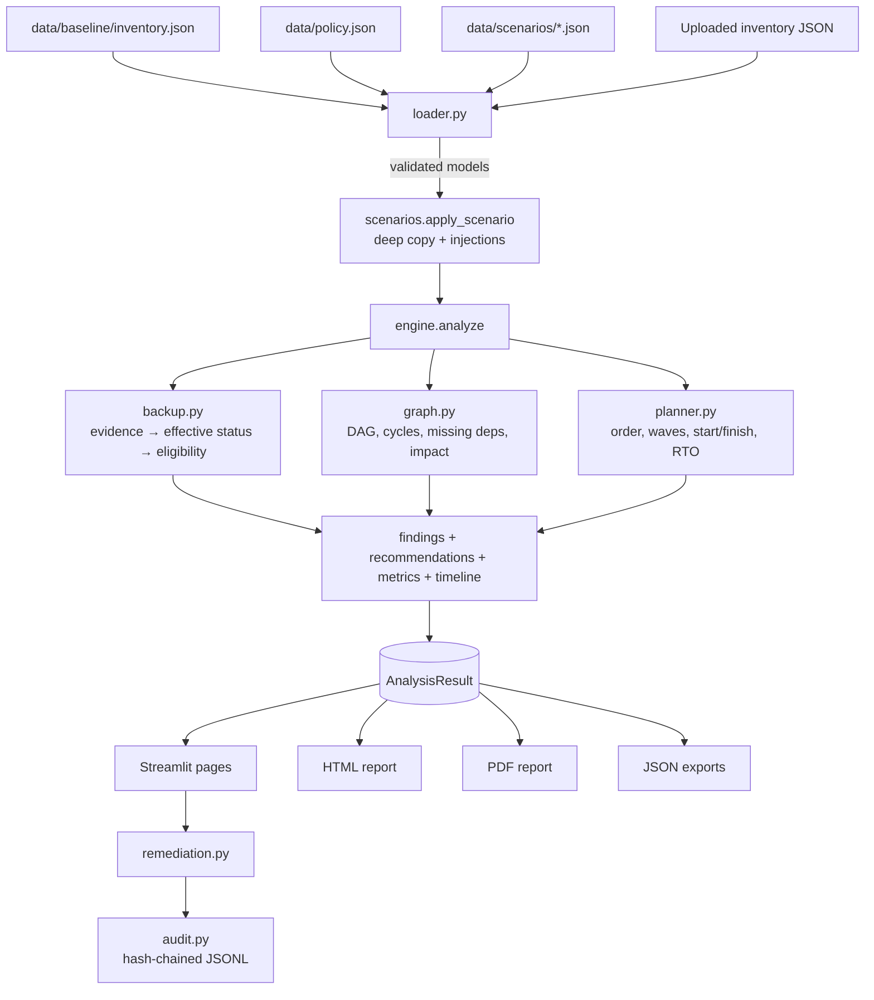

# Architecture

## Goals that shaped the design

1. **One source of truth.** The engine produces a single `AnalysisResult`. The dashboard,
   HTML/PDF reports, JSON exports and CLI only *render* it, so they cannot disagree.
2. **Deterministic and explainable.** No randomness, no wall-clock inside the analysis
   (only `generated_at` records when a report was produced), no ML. Every finding carries
   a rule ID, a basis label, evidence IDs and, where relevant, its calculation.
3. **Safe by default.** Works offline on synthetic data; no credentials; nothing is
   ever changed outside the local `var/` state directory.
4. **Small dependency surface.** Pydantic, NetworkX, pandas, Plotly, Streamlit, Jinja2, fpdf2.
   The PDF library is pure Python, so it needs no system libraries.

## Data flow

## Modules (`src/recoveryproof/`)

| Module | Responsibility |
|---|---|
| `models.py` | Input schema: `Asset`, `RecoveryPoint`, `BackupPolicy`, `RepositoryConfig`, `Evidence`, `Inventory`, `OrgPolicy`, `Scenario` + 7 injection types. Rejects unknown fields and naive timestamps; enforces referential integrity |
| `loader.py` | Safe file loading: `.json` only, 2 MiB cap, path-traversal/symlink-escape protection, readable error messages |
| `scenarios.py` | Applies injections (`compromise_assets`, `mark_unrecoverable`, `backup_job_failure`, `corrupt_recovery_points`, `compromise_principal`, `repository_outage`, `delete_recovery_points`) to a deep copy; records simulated timeline events and evidence |
| `backup.py` | Combines tool-reported status with evidence (conservatively), decides recovery-point eligibility, immutability/exposure, isolation, restore-test recency |
| `graph.py` | NetworkX DAG (`dependency → dependent`), cycles (SCCs), cycle-blocked descendants, missing dependencies, deterministic priority topological order, shared-dependency detection |
| `planner.py` | Recovery plan: blocked propagation, waves, start/finish minutes, parallel/serial/lower-bound estimates, RTO status |
| `engine.py` | Orchestration, scoring, rule evaluation → findings, recommendations, metrics, timeline |
| `rules.py` | Rule catalogue (23 rules): severity per tier and remediation guidance |
| `compare.py` | Before/after comparison and expected-vs-actual checks for scenarios |
| `remediation.py` | Status tracker (open → acknowledged → resolved); resolution requires a verification record |
| `audit.py` | Append-only, SHA-256 hash-chained JSONL audit log with secret-key redaction |
| `reporting/` | Jinja2 HTML (autoescaped), fpdf2 PDF, JSON exports, sharing one content module |
| `ui/` | Streamlit shell, pages, Plotly charts, escaped HTML components, session state |
| `cli.py` | `recoveryproof scenarios / analyze / report` |

## Key design decisions

**Dependency direction.** `depends_on` lists prerequisites. Edges go `dependency → dependent`,
so a topological order is a valid restore order. Among ready assets the planner picks higher
criticality, then shorter RTO, then ID, via `lexicographical_topological_sort`. The order is
deterministic and never hard-coded per scenario.

**Cycles and gaps block; they never guess.** Nodes in a strongly connected component, and
everything downstream, are marked blocked with an explanation (DEP-002). Assets that depend
on uninventoried systems are blocked (DEP-001). No "best effort" order is produced for them.

**Readiness is a capability measure.** The RTO component of the score always comes from a
full-environment rehearsal plan. Scores can therefore be compared across scenarios: Scenario A
(intact backups) keeps the baseline score while its business impact rises to 55%. The
scenario's own plan drives RTO findings and the Recovery Plan page. The comparison view
refuses to compare RTO counts between plans that restore different systems.

**Unknown is not success.** Missing RTO/RPO, missing restore durations, unverified integrity
and unevidenced immutability all earn no score credit and appear as "Unknown"/"Not verified".
Durations unknown upstream propagate: the plan reports a lower bound instead of a total.

**Isolated copies keep the source's `created_at`.** RPO depends on the data's point in time,
not on when the copy job ran.

**Persistence.** Only two small local files: `var/audit.jsonl` and `var/remediation.json`
(atomic writes). SQLite was not needed.

## Deployment

Local only by design: `streamlit run app.py` (binds to localhost by default). No cloud
deployment is provided or required. An optional, *unapplied* least-privilege AWS IAM role
template lives in `infra/terraform/readonly-evidence-role/` for a future read-only collector.
